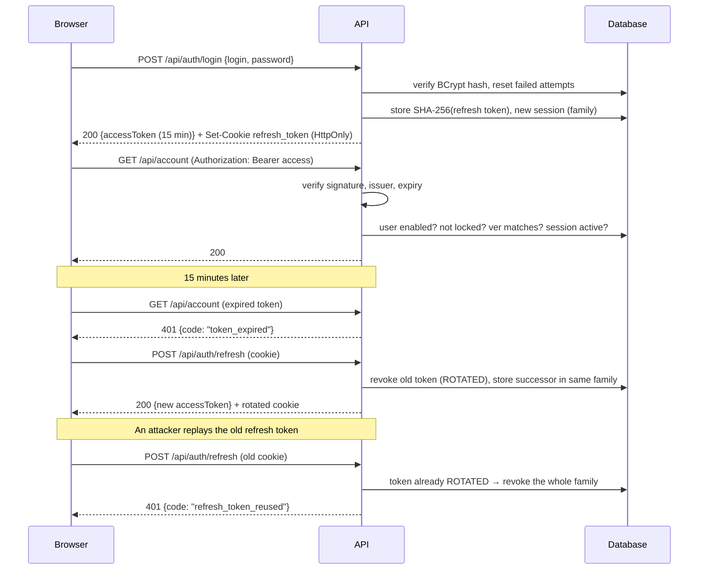

# JWT Authentication System


A production-style authentication and authorization service built with **Spring Boot 4**, **Spring Security** and
**JWT**. It goes beyond a basic "login returns a token" demo. Access tokens are short-lived, refresh tokens rotate
and detect theft, logout and role changes take effect immediately, and every security-relevant action is audited.
A small web console shows the whole token lifecycle live.

## Highlights

| | |
|---|---|
| **Short-lived access tokens** | HS256 JWTs valid for 15 minutes, carrying user id, role, permissions, session id and token version. Kept in memory by the client, never in `localStorage`. |
| **Rotating refresh tokens** | 256-bit random tokens in an `HttpOnly`, `Secure`, `SameSite=Strict` cookie scoped to `/api/auth`. Only a SHA-256 hash is stored. Every refresh issues a new one. |
| **Reuse detection** | Presenting an already-rotated refresh token means it was copied. The whole session is revoked and a `TOKEN_REUSE_DETECTED` event is logged. |
| **Instant revocation** | Each request checks the token's session and `ver` claim against the database. Logout, "log out everywhere", password change, role change and account disable apply at once, not when the token expires. |
| **RBAC with permissions** | Roles (`USER`, `MODERATOR`, `ADMIN`) map to permissions (`profile:read`, `users:read`, `users:write`, `audit:read`…), checked with `@PreAuthorize`. |
| **Brute-force protection** | Account lockout after 5 wrong passwords (15 min). Per-IP rate limit on login and register (`429` + `Retry-After`). The same response for an unknown user as for a wrong password, with timing equalised by a dummy BCrypt check. |
| **Password policy** | 8–72 characters (BCrypt's limit), mixed case and a digit, no common passwords, must not contain the username or e-mail name. Hashes use `{bcrypt}` through a delegating encoder, so the algorithm can be upgraded later. |
| **Sessions** | Users see every signed-in device (browser, OS, IP, last refresh) and can sign one out, or all. |
| **Audit log** | Logins, failures, lockouts, token reuse, password and role changes, recorded with actor and IP. |
| **Clear errors** | Every error is JSON with a stable `code` (`token_expired`, `token_stale`, `session_ended`, `account_locked`, `rate_limited`…), so clients know whether to refresh or re-authenticate. |
| **Engineering** | Flyway migrations, PostgreSQL / H2, 38 tests (unit + MockMvc integration), GitHub Actions CI, Docker, docker-compose, Render blueprint, OpenAPI / Swagger UI. |

## How the tokens work



**Why both a token version and a session check?** The JWT signature only proves the token was issued by this
server. The two database checks let the server withdraw a token before it expires:
- `sid` (the session) ends on logout or when a device is signed out;
- `ver` (the user's token version) is bumped on password change, role change, "log out everywhere" and disable.

## Try it

The fastest way is with Java 21+:

```bash
git clone https://github.com/Tanvi958/JWT-Authentication-System.git
cd JWT-Authentication-System
./mvnw spring-boot:run          # Windows: mvnw.cmd spring-boot:run
```

Open http://localhost:8080 and sign in with a demo account (one-click buttons on the sign-in page):

| Username | Password | Role | Can |
|---|---|---|---|
| `admin` | `SuperUser@1` | ADMIN | everything, including changing users and reading the audit log |
| `moderator` | `Reviewer@1` | MODERATOR | moderate content, view users |
| `user` | `Member@123` | USER | manage their own profile and sessions |

In the console you can:
- watch the access token decode and count down;
- refresh it and see rotation;
- run the access-check matrix against each role;
- try to forge an admin token (the server rejects it);
- sign out other devices, change roles as admin, and watch the audit log fill up.

API docs: http://localhost:8080/swagger-ui.html. Log in, copy the `accessToken`, then press **Authorize**.

### With PostgreSQL (Docker)

```bash
docker compose up --build
```

### Tests

```bash
./mvnw test
```

| Test class | Covers |
|---|---|
| `JwtServiceTest` | claims, expiry, tampered payload, wrong key, wrong issuer, `alg: none`, short secrets |
| `PasswordPolicyTest` | every password rule |
| `AuthFlowTests` | register, login, cookie flags, lockout, refresh rotation, reuse detection, logout, sessions, password change |
| `AccessControlTests` | role/permission matrix, role change forcing a refresh, disable/enable, unlock, admin safety rules, security headers |
| `RateLimitTests` | `429` with `Retry-After` |

## API

| Method | Endpoint | Access | Purpose |
|---|---|---|---|
| POST | `/api/auth/register` | public | Create an account (role USER) |
| POST | `/api/auth/login` | public, rate-limited | `{login, password}` → access token + refresh cookie |
| POST | `/api/auth/refresh` | refresh cookie | New access token, rotated cookie |
| POST | `/api/auth/logout` | refresh cookie | End this session |
| POST | `/api/auth/logout-all` | signed in | End every session |
| GET / PUT | `/api/account` | `profile:read` / `profile:write` | View / update own profile |
| PUT | `/api/account/password` | `profile:write` | Change password (signs out everywhere) |
| GET | `/api/account/sessions` | `profile:read` | Signed-in devices |
| DELETE | `/api/account/sessions/{id}` | `profile:write` | Sign out one device |
| GET | `/api/account/events` | `profile:read` | Own security activity |
| GET | `/api/admin/users` | `users:read` | Search users |
| PUT | `/api/admin/users/{id}/role` | `users:write` | Change role |
| PUT | `/api/admin/users/{id}/status` | `users:write` | Enable / disable |
| POST | `/api/admin/users/{id}/unlock` | `users:write` | Clear a lockout |
| DELETE | `/api/admin/users/{id}/sessions` | `users:write` | Sign a user out everywhere |
| GET | `/api/admin/audit` | `audit:read` | Audit log, filter by `type` |
| GET | `/api/demo/{public,user,moderator,admin}` | increasing | Access-control demo |

Example error:

```json
{ "status": 401, "error": "Unauthorized", "code": "token_expired",
  "message": "The access token has expired", "path": "/api/account", "fieldErrors": null }
```

## Configuration

| Variable | Default | |
|---|---|---|
| `JWT_SECRET` | dev value | HS256 key, 32+ characters. **Set your own in production.** |
| `ACCESS_TOKEN_TTL` / `REFRESH_TOKEN_TTL` | `15m` / `7d` | Token lifetimes |
| `DB_URL`, `DB_USERNAME`, `DB_PASSWORD` | in-memory H2 | e.g. `jdbc:postgresql://localhost:5432/authdb` |
| `LOCKOUT_MAX_ATTEMPTS` / `LOCKOUT_DURATION` | `5` / `15m` | Lockout policy |
| `AUTH_RATE_LIMIT` | `20` | Login/register requests per minute per IP |
| `COOKIE_SECURE` | `true` | Set `false` only for plain-HTTP local setups other than localhost |
| `CORS_ALLOWED_ORIGINS` | empty | Comma-separated origins of a separately hosted front-end |
| `SEED_DEMO_USERS` | `true` | Create the three demo accounts in an empty database |

**Deploy on Render:** New → Blueprint → select this repository. `render.yaml` provisions the app, a PostgreSQL
database and a random `JWT_SECRET`.

## Design decisions

- **Refresh token in a cookie, access token in memory.** JavaScript can't read an HttpOnly cookie, so an XSS bug
  can't steal the long-lived credential. `SameSite=Strict` plus the `/api/auth` path stop other sites from using
  it, which is why CSRF protection can stay off for this stateless, header-authenticated API.
- **Opaque refresh tokens, stored hashed.** They never need to be read by clients, can be revoked, and a database
  leak doesn't expose usable tokens.
- **Authorities come from the database, not the token.** The token's `ver` claim guarantees it matches the current
  role, and the filter loads the user anyway to check that it's enabled, unlocked and the session still active.
- **HS256 over RS256.** One service both issues and verifies the tokens, so a shared secret is enough. RS256
  would make sense once other services need to verify tokens without being able to mint them.
- **In-memory rate limiting.** Simple and correct for one instance. With several instances it would move to
  Redis or the API gateway.

## Project structure

```
src/main/java/com/tanvi/auth/
  config/       properties, demo accounts, OpenAPI
  domain/       User, Role, Permission, RefreshToken, SecurityEvent
  repository/   Spring Data JPA repositories
  security/     SecurityConfig, JwtService, JwtAuthenticationFilter, RateLimitFilter, PasswordPolicy
  service/      AuthService, SessionService, AccountService, AdminService, AuditService, clean-up job
  web/          controllers, DTOs, refresh cookie, error handling
src/main/resources/
  db/migration/ Flyway SQL
  static/       the web console (HTML, CSS, vanilla JS)
```
